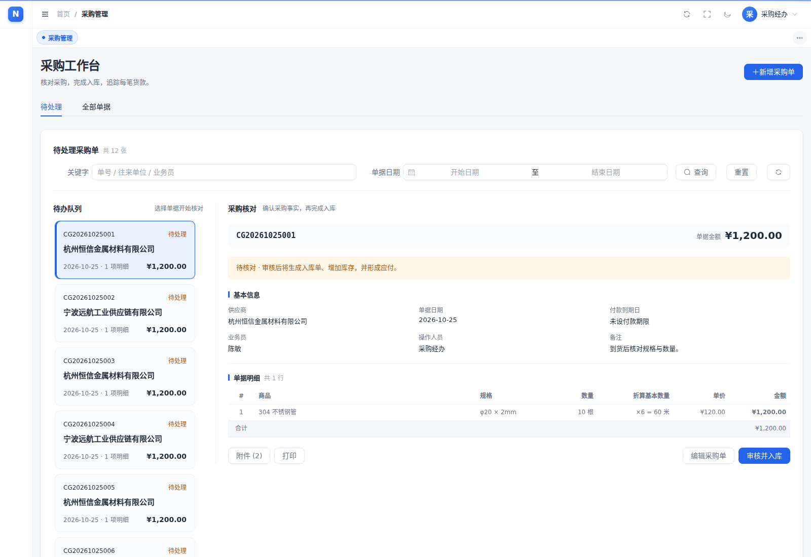

# 采购工作台

本次界面以频繁录入和核对采购的经办人员为暂定主要用户。Goodwin 方法决定目标、活动视图和关键路径；Refactoring UI 决定层级、间距、信息分组及动作强调。当前方案没有真实用户研究验证。



- 待处理：左侧分页队列，右侧核对明细、附件、打印、编辑与审核。核心内容持续可见。
- 全部单据：保留分页表格，单号直接打开详情，辅助操作收进更多菜单。
- 付款到期日明确用途；未审核不显示已形成的应付状态。
- 审核仍按现有业务规则生成入库并调整库存，确认窗明确后果。成功保留结果，再继续下一张。
- 请求失败保留输入并支持重试；保护未保存修改；筛选及分页可通过 URL 刷新恢复。
- 窄屏在队列与详情之间切换，返回保留选中与焦点。亮暗主题沿用原有令牌。

## 验证

```bash
cd frontend
npm ci
npm test
npm run build
npx playwright install chromium
npm run test:purchase
```

本次结果：27 项单元测试通过；类型检查与生产构建通过；14 个采购浏览器场景通过，未捕获浏览器异常为 0。

采购浏览器脚本自动启动 Vite，使用模拟 API 驱动真实 Vue 页面。覆盖加载/失败/恢复、慢响应竞态、保存、审核、分页、中文下拉与日历、只读权限、窄屏焦点和销售列表回归。截图为模拟数据，不证明真实后端入库或付款事务已验收。

新增 `useTableQuery` 测试覆盖刷新失败保留已有数据，以及旧失败响应不能影响新请求的状态。GitHub Actions `Purchase UI` 执行单元测试、构建与采购浏览器测试。

`DESIGN.md` lint 为零错误、零警告。全项目静态审计剩余一项既有误报：`TagsView.vue` 的 ElDropdown 触发按钮由父组件绑定行为，扫描器只识别直接点击属性；采购浏览器脚本额外验证此菜单可打开。

原 `scripts/interaction-verify.mjs` 在此环境启动浏览器失败（CDP 9352 连接拒绝），不能算通过；本次以新增的采购专项浏览器脚本提供界面回归证据。未运行真实后端端到端联调。

## 业务边界

采购单审核即入库、已有付款不可反审核、单据与操作权限均保持现有规则。没有新增交期预警、分批到货或生产关联；没有改动 Java/Go 后端。跨页的入库明细与付款流水联查仍是后续扩展。

视觉规范见根目录 `DESIGN.md`，交互规范与来源见 `UX-CONTRACT.md`。
