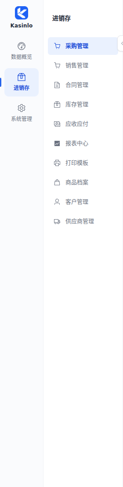
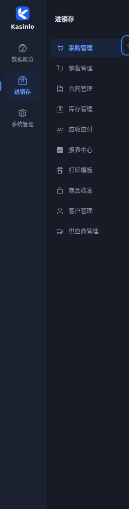

# 侧栏视觉与产品图标

一级导航采用图标在上、名称在下的排布，四字名称保持单行。二级导航保持紧凑列表，两栏通过表面底色、文字权重和选中状态区分。展开总宽 280px、收起 132px，一级栏展开时宽 98px；右边缘箭头、点击一级分组自动展开和二级分组折叠状态继续沿用现有交互。

侧栏与浏览器图标共用 `frontend/public/brand/kasinlo-mark.png`，发布资源为 128×128 PNG，约 12KB，侧栏显示 30×30。导航图标继续使用 AppIcon。颜色只消费现有语义令牌；选中文字使用 `--tone-blue`，亮暗主题均检查至少 4.5:1 的对比度。键盘焦点可见，减少动态效果时取消侧栏过渡。

## 图标生成

使用内置 imagegen 生成，再按网页资源尺寸导出。生成提示原文：

> Use case: logo-brand. Asset type: production app icon for Kasinlo ERP, displayed at 28-32px on a light sidebar. Create one single square blue app mark: a bold white geometric K built from three interlocking ribbon-like modules, suggesting connected procurement, inventory and sales. Very simple confident silhouette, generous strokes and negative space that remain readable at 24px. Cobalt blue #2563eb rounded square tile, subtle azure #3b82f6 variation at most, crisp flat vector-like edges. Straight-on, centered, tile fills the square canvas edge-to-edge, no surrounding margin or scene. No words, no extra letters, no mockup, no 3D, no shadow outside the tile, no watermark. One icon only.

## 验证

27 项单元测试、类型检查与生产构建、18 个浏览器场景通过，浏览器未捕获异常为 0。运行 `cd frontend && npm test && npm run build && npm run test:purchase`。浏览器脚本使用模拟 API 与真实 Vue 界面，覆盖原有采购流程以及完整导航、图标加载、隐藏菜单、路由高亮、分组浏览、展开收起、分组折叠保留、键盘操作、亮暗对比度、窄屏与 reduced-motion。测试的编辑响应与新建响应都补齐商品快照，避免把提交请求体误当作真实 API 的详情响应。

静态严格审计仍有一项既有 TagsView 的 ElDropdown 触发按钮误报；浏览器脚本验证该菜单可以打开。浏览器证据不代表真实后端事务验收。
